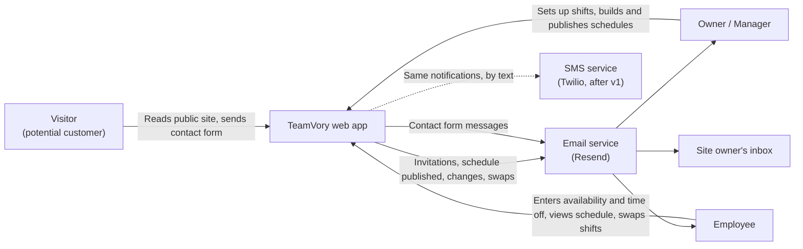
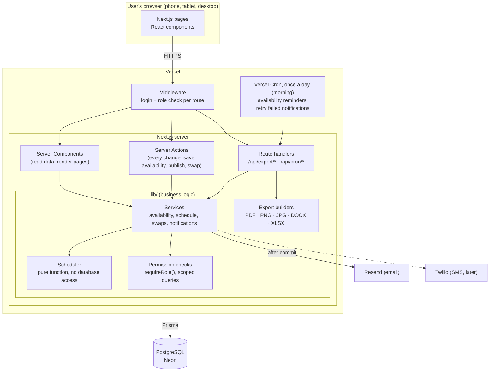
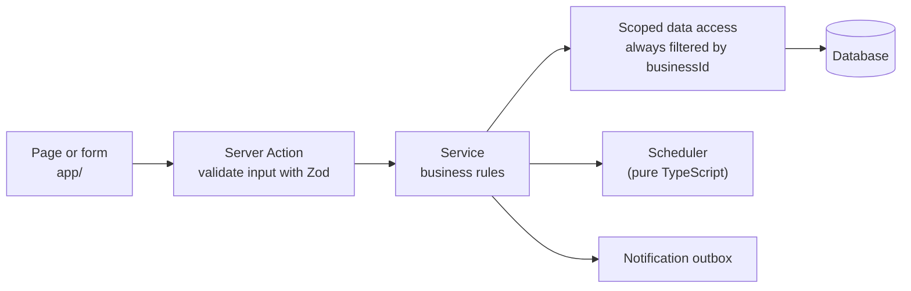
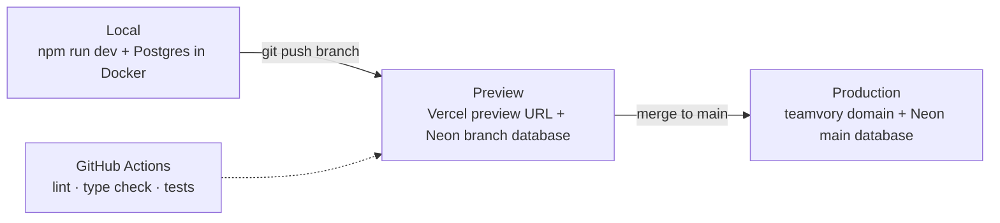

# Architecture

> Phase 5: Technical design. Builds on `technical-plan.md` (stack) and `user-flows.md`.

## 1. System context

Who and what TeamVory talks to.

## 2. Containers (what runs where)

## 3. Layers inside the app

Every request follows the same path. The UI never talks to the database directly.

| Layer | Folder | Responsibility | Rule |
|---|---|---|---|
| Pages | `app/` | Show data, collect input | No business logic, no direct database calls |
| Server Actions | `app/**/actions.ts` | Check input (Zod), get the signed-in user, call one service | Thin: about 10 lines each |
| Services | `lib/services/` | Business rules: eligibility, versioning, conflicts | Receive a context `{ userId, businessId, role }` and check permissions first |
| Data access | `lib/db/` | Prisma queries | Every query includes `businessId`. No query without it |
| Scheduler | `lib/scheduler/` | Builds a schedule from shifts + availability | No database, no dates "now"; same input + seed gives the same output, which makes it easy to test |
| Notifications | `lib/notifications/` | Writes a notification record, then sends it | One sender for email now and SMS later |

## 4. Key technical decisions

| # | Decision | Why |
|---|---|---|
| 1 | **One Next.js app** for the public site, manager and employee areas | One deploy, shared login and components. Fine for this size |
| 2 | **Server Actions** instead of a separate REST API | Less code. A public API can be added later if a mobile app is ever built |
| 3 | **Times stored as the business's local wall-clock time** (`date` + `"14:00"`) with the business time zone `America/New_York` | A 2–5 PM shift stays 2–5 PM across the EDT/EST switch. Converted to exact instants only for emails and reminders |
| 4 | **Shifts never cross midnight** (end time later than start time) | Matches the business (latest close 9 PM). Keeps hour math simple. Can be relaxed later |
| 5 | **Hours are calculated, not stored** | Totals can never drift out of sync with the shifts |
| 6 | **Optimistic locking**: schedules carry a `lockVersion` | Two people editing at once can't silently overwrite each other (NFR "Reliability") |
| 7 | **Notification outbox**: the notification is saved in the same transaction as the change, then sent right after | A failed email is retried by the daily cron instead of being lost. `dedupeKey` stops duplicates |
| 8 | **Open-shift pickup in a database transaction** with a row lock | When two people tap "Pick up" at the same moment, only the first succeeds |
| 9 | **Exports generated on demand** in a route handler | No file storage needed. They always reflect the selected schedule version |
| 10 | **JWT sessions** (Auth.js) with role and business in the token, re-checked on every change | Fast page loads, and permission changes still take effect on the next action |

## 5. Security

- **Passwords:** hashed with Argon2 (or bcrypt). Invitation and reset links store only a hash of the token, expire after 72 h / 1 h, and work once.
- **Three permission checks** (details in `permissions.md`):
  1. Middleware blocks `/manager/*` for employees and `/employee/*` for inactive users.
  2. Every service checks the role before doing anything.
  3. Every query is filtered by `businessId`, and employee-only actions also check that the record belongs to them.
- **Input validation:** Zod on every Server Action. Never trust IDs sent from the browser; look them up within the user's business.
- **Rate limiting** on login, password reset and the contact form (to stop spam and password guessing).
- **Privacy:** store only name, email and phone. Employees can't see coworkers' contact details.
- **Audit log:** schedule publishes, swaps, availability entered by a manager, and role changes are recorded with who did it and when.

## 6. Environments and deployment

| Environment | Database | Email | Purpose |
|---|---|---|---|
| Local | Docker Postgres with sample data | Logged to console | Development |
| Preview | Neon branch (copy of test data) | Resend test mode | Review each change, show the client |
| Production | Neon main, daily backups | Resend live | Real use |

Secrets (database URL, auth secret, Resend key) live in Vercel environment variables, never in the code.
