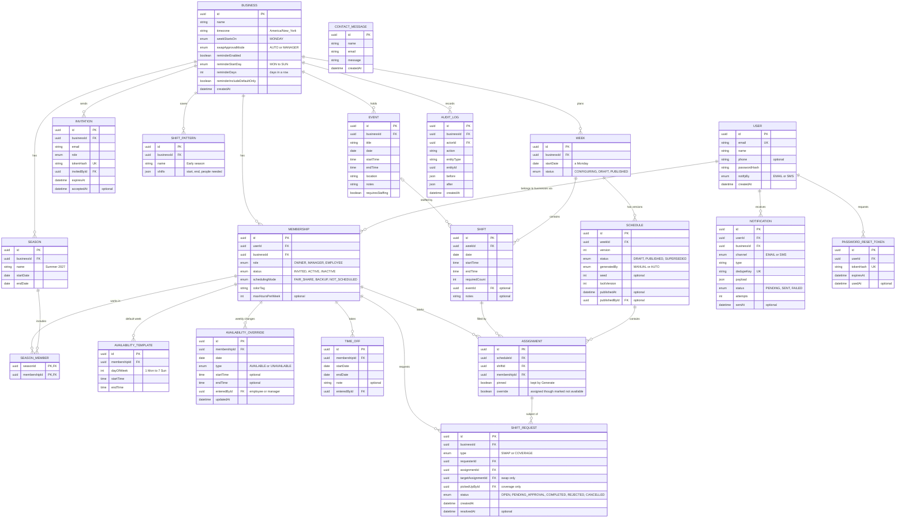

# Database design (ERD)

> Phase 5: Technical design. PostgreSQL with Prisma. Replaces the draft table list in `technical-plan.md` §3.

## 1. Diagram

`CONTACT_MESSAGE` belongs to the public website, not to a business. It's saved as a backup of the email sent to the site owner.

## 2. Why it's shaped this way

| Choice | Reason |
|---|---|
| **User** and **Membership** are separate | One person (one login) could later work for two businesses that both use TeamVory. Role and active/inactive status belong to the membership, not the person |
| `schedulingMode` on Membership | The owner works shifts too. Employees are *fair share*; the owner is *backup* by default: he picks his own shifts and covers whatever nobody else can (decision 19). *Not scheduled* is for managers who don't work shifts |
| `override` on Assignment | The manager may add someone who marked themselves not available, after agreeing with them (decision 20). The flag shows the *agreed* tag and stops it being reported as a conflict |
| Reminder settings on **Business** | One set of reminder choices per business (decision 26). Who gets reminded is worked out when sending, not stored |
| *(On hold)* **CalendarFeed** + `externalUid` on Event | Only if calendar sync goes ahead (decision 27): events imported from the owner's phone calendar. The calendar's own event ID matches updates and deletions, so re-syncing never creates duplicates. Unique (`calendarFeedId`, `externalUid`) |
| `pinned` on Assignment | Shifts the owner puts himself on (or any shift placed by hand and pinned) survive Generate and Regenerate |
| Availability = **template + overrides** | The default week is entered once; each week only stores the days that differ (decision 7) |
| Overrides keyed by **date**, not by week | Availability can be entered for any future week before that week is set up |
| **TimeOff** has no status | No approval needed for this client (decision 9) |
| **Week → Shift** separate from **Schedule → Assignment** | Shift setup (what's needed) stays fixed while the manager regenerates schedules (who works). The spec requires regenerating "without changing the underlying shift configuration" |
| **Schedule versions** | Publishing again creates a new version; the old one becomes SUPERSEDED and stays in history. Exports can pick any version |
| No `hours` column on Assignment | Hours come from the shift's start and end, so they can't get out of sync |
| **ShiftPattern** stores shifts as JSON | Patterns are only templates; they're copied into real Shift rows when applied, so editing a pattern never changes past weeks |
| `businessId` on top-level tables | Every query can filter by business (data isolation, future multi-business support) |

## 3. Rules the database enforces

| Rule | How |
|---|---|
| One membership per person per business | Unique (`userId`, `businessId`) |
| One week record per Monday | Unique (`businessId`, `startDate`) |
| No double-booking the same person on the same shift | Unique (`scheduleId`, `shiftId`, `membershipId`) on Assignment |
| Only one draft and one published schedule per week | Partial unique indexes on (`weekId`) where `status = 'DRAFT'` and where `status = 'PUBLISHED'` |
| Shift times make sense | Check: `endTime > startTime`, `requiredCount >= 1` |
| Time off dates make sense | Check: `endDate >= startDate` |
| No duplicate emails | Unique `dedupeKey` on Notification, e.g. `publish:{scheduleId}:{userId}` |
| Overlapping shifts for one person | Checked in the service layer (needs time comparison across rows) and re-checked inside the swap/pickup transaction |

## 4. Indexes for common screens

| Screen | Index |
|---|---|
| Availability overview for a week | AvailabilityOverride (`membershipId`, `date`); TimeOff (`membershipId`, `startDate`, `endDate`) |
| Weekly schedule | Shift (`weekId`, `date`); Assignment (`scheduleId`); Assignment (`membershipId`) |
| Employee dashboard / My schedule | Assignment (`membershipId`) joined to the published schedule |
| Open shifts list | ShiftRequest (`businessId`, `status`) |
| Notification retry job | Notification (`status`, `attempts`) |

## 5. Deleting data

- Employees are never deleted, only set to INACTIVE, so past schedules and hour reports stay correct.
- Events, shift patterns and draft schedules can be deleted.
- Published schedules are never deleted; they become SUPERSEDED.
- If someone asks for their personal data to be removed, their name, email and phone are anonymized and the shifts they worked are kept.
