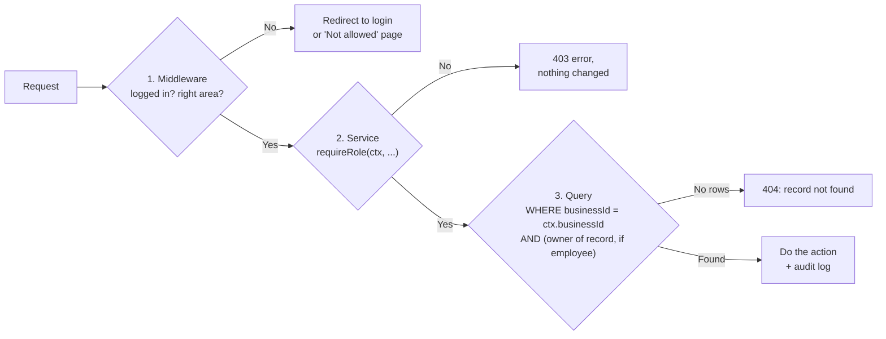

# Roles and permissions

> Phase 5: Technical design. Covers the spec requirement "role-based permissions for managers and employees" and the NFRs on security and data isolation.

## 1. Roles

| Role | Who | In one sentence |
|---|---|---|
| **Visitor** | Anyone not logged in | Sees the public website and can send the contact form |
| **Owner** | The person who created the business | Everything a manager can do, plus business settings and managing managers |
| **Manager** | Someone the owner promotes | Runs the schedule day to day |
| **Employee** | Invited staff | Manages their own availability and time off, sees the published schedule, trades shifts |
| **Inactive employee** | Staff not working this season | Can't access the employee area; kept for history and next season |

Owner and Manager are both "managers" in the app. The only differences are in the **Owner only** rows below.

## 2. Permissions matrix

**Key:** ✅ allowed · 👤 only their own · 👁 view only · — not allowed

### Business and people

| Action | Owner | Manager | Employee | Inactive |
|---|:-:|:-:|:-:|:-:|
| Edit business info, time zone, swap approval setting | ✅ | — | — | — |
| Promote an employee to manager / demote a manager | ✅ | — | — | — |
| Invite employees | ✅ | ✅ | — | — |
| Edit employee details, set active / inactive | ✅ | ✅ | — | — |
| Change an owner's or manager's role or status | ✅ | — | — | — |
| Season roster (who's back this season) | ✅ | ✅ | — | — |
| See employee list with contact details | ✅ | ✅ | — | — |
| See coworkers' names (on the published schedule) | ✅ | ✅ | ✅ | — |
| Edit own profile (name, phone, password, email/SMS preference) | ✅ | ✅ | 👤 | — |

### Availability and time off

| Action | Owner | Manager | Employee | Inactive |
|---|:-:|:-:|:-:|:-:|
| Set default week and weekly changes | ✅ for anyone | ✅ for anyone | 👤 | — |
| Add, edit, delete time off | ✅ for anyone | ✅ for anyone | 👤 | — |
| See everyone's availability and time off | ✅ | ✅ | — | — |

### Shifts and schedules

| Action | Owner | Manager | Employee | Inactive |
|---|:-:|:-:|:-:|:-:|
| Create / edit shift patterns | ✅ | ✅ | — | — |
| Set up a week's shifts | ✅ | ✅ | — | — |
| Build a schedule by hand, generate, regenerate | ✅ | ✅ | — | — |
| See draft schedules | ✅ | ✅ | — | — |
| Publish / republish a schedule | ✅ | ✅ | — | — |
| See the published schedule (whole team) | ✅ | ✅ | 👁 | — |
| See hour totals | ✅ everyone | ✅ everyone | 👤 own only | — |

### Shift requests

| Action | Owner | Manager | Employee | Inactive |
|---|:-:|:-:|:-:|:-:|
| Request a swap / post an open shift | — | — | 👤 own shifts | — |
| Accept a swap offered to me | — | — | 👤 | — |
| Pick up an open shift | — | — | ✅ if eligible | — |
| Cancel my request (before it completes) | — | — | 👤 | — |
| Approve / reject swaps (when approval is on) | ✅ | ✅ | — | — |
| See all requests | ✅ | ✅ | 👤 own + open shifts | — |

If the owner or a manager works shifts (scheduling mode *fair share* or *backup*; the owner is *backup* by default), they can also use the employee actions above for their own shifts.

### Events, reports, exports

| Action | Owner | Manager | Employee | Inactive |
|---|:-:|:-:|:-:|:-:|
| Create / edit / delete events | ✅ | ✅ | — | — |
| See events | ✅ | ✅ | 👁 staffed events on their shifts | — |
| Reports and exports (PDF, PNG, JPG, Word, Excel) | ✅ | ✅ | — | — |
| Download / print my own schedule | ✅ | ✅ | 👤 | — |
| See the audit log | ✅ | ✅ | — | — |

## 3. What employees can see about coworkers

To protect privacy, an employee sees **only**:
- coworkers' names, color tags and published shifts (needed to know who they work with and to choose a swap);
- for swaps, a short reason when a swap isn't possible, such as "Ben isn't available Tue 5–9 PM". They never see anyone's full availability, time off notes, hours totals, email or phone.

## 4. How it's enforced

Three checks, so one mistake can't expose data:

| Check | Where | Example |
|---|---|---|
| 1. Route | `middleware.ts` | Employee opens `/manager/schedule` → redirected to `/employee` |
| 2. Role | Start of every service function | `requireRole(ctx, ["OWNER", "MANAGER"])` before publishing |
| 3. Data | Every database query | Employee edits time off `id=123` → query also requires `membershipId = ctx.membershipId`; someone else's record returns "not found" |

Rules:
- The role and business always come from the **server session**, never from the browser.
- When someone is set to inactive or demoted, it takes effect on their next action (the role is re-read from the database for every change).
- Records from another business return "not found", not "forbidden", so their existence isn't revealed.

## 5. Tests

Each ✅ / — cell above becomes an automated test: sign in as that role, try the action, and check that it succeeds or is refused. The highest-risk cases come first:
1. An employee can't open any `/manager` page or call a manager action directly.
2. An employee can't edit another employee's availability or time off.
3. An employee can't see draft schedules.
4. A manager can't change business settings or other managers.
5. An inactive employee can't log in to the employee area.
6. A user from business A can't read or change anything in business B.
