# Sitemap

> Phase 4 — Information architecture. Updated from the sitemap in the requirements document to match the client decisions (see `technical-plan.md` §7).

## Diagram

```mermaid
flowchart TD
    ROOT["TeamVory"]

    ROOT --> PUB["Public website"]
    ROOT --> AUTH["Account pages"]
    ROOT --> MGR["Manager area"]
    ROOT --> EMP["Employee area"]

    PUB --> P1["Home"]
    PUB --> P2["How it works"]
    PUB --> P3["About us"]
    PUB --> P4["Contact (form)"]
    PUB --> P5["Privacy Policy"]
    PUB --> P6["Terms"]

    AUTH --> A1["Sign up (new business)"]
    AUTH --> A2["Log in"]
    AUTH --> A3["Forgot / reset password"]
    AUTH --> A4["Accept invitation"]

    MGR --> M1["Dashboard"]
    MGR --> M2["Employees"]
    M2 --> M2a["Season roster"]
    M2 --> M2b["Invite employee"]
    MGR --> M3["Availability"]
    M3 --> M3a["Edit for an employee"]
    M3 --> M3b["Time-off calendar"]
    MGR --> M4["Shift setup"]
    M4 --> M4a["Shift patterns"]
    MGR --> M5["Weekly schedule"]
    M5 --> M5a["Generate / regenerate"]
    M5 --> M5b["Publish + version history"]
    MGR --> M6["Events"]
    MGR --> M7["Reports & exports"]
    MGR --> M8["Business settings"]

    EMP --> E1["Dashboard"]
    EMP --> E2["My availability"]
    E2 --> E2a["Default week"]
    E2 --> E2b["This week's changes"]
    E2 --> E2c["Time off"]
    EMP --> E3["My schedule"]
    EMP --> E4["Shift requests"]
    E4 --> E4a["Swap with coworker"]
    E4 --> E4b["Open shifts"]
    EMP --> E5["My profile"]
```

## Page reference

| Area | Page | Route | Who | What's on it |
|---|---|---|---|---|
| Public | Home | `/` | Everyone | Service intro, benefits, main features, sign-up / log-in buttons |
| Public | How it works | `/how-it-works` | Everyone | The weekly cycle: availability → shifts → generate → publish |
| Public | About us | `/about` | Everyone | Mission and values of the business behind TeamVory |
| Public | Contact | `/contact` | Everyone | Form; messages are emailed to the site owner |
| Public | Privacy / Terms | `/privacy`, `/terms` | Everyone | Required for a public service that stores personal data |
| Account | Sign up | `/signup` | New owner | Creates a user **and** a business workspace |
| Account | Log in | `/login` | All users | Sends owners/managers to `/manager`, employees to `/employee` |
| Account | Forgot / reset password | `/forgot-password`, `/reset-password/[token]` | All users | Email link to set a new password |
| Account | Accept invitation | `/invite/[token]` | Invited employee | Set name + password, joins the business |
| Manager | Dashboard | `/manager` | Owner, Manager | This week at a glance: unfilled shifts, conflicts, open shifts, pending approvals, who hasn't updated availability, upcoming events |
| Manager | Employees | `/manager/employees` | Owner, Manager | List, invite, edit, set active/inactive |
| Manager | Season roster | `/manager/employees/season` | Owner, Manager | Check who is back this season; others stay inactive |
| Manager | Availability | `/manager/availability?week=` | Owner, Manager | Everyone's availability for the week; edit for an employee; see everyone's time off |
| Manager | Shift setup | `/manager/shifts?week=` | Owner, Manager | Copy last week or apply a pattern, then edit single days |
| Manager | Shift patterns | `/manager/shifts/patterns` | Owner, Manager | Saved patterns like *Early / Mid / Late season* |
| Manager | Weekly schedule | `/manager/schedule?week=` | Owner, Manager | Assign by hand or generate; hour totals vs fair target; publish |
| Manager | Events | `/manager/events` | Owner, Manager | Create / edit / delete; shown in the planning view |
| Manager | Reports & exports | `/manager/reports` | Owner, Manager | Hours by employee; download PDF, PNG, JPG, Word, Excel |
| Manager | Business settings | `/manager/settings` | Owner | Business info, time zone, swap approval mode, availability reminders |
| Employee | Dashboard | `/employee` | Employee | Next shifts, hours this week, open shifts I can take, my pending requests |
| Employee | My availability | `/employee/availability` | Employee | Default week, this week's changes, time off |
| Employee | My schedule | `/employee/schedule` | Employee | Published shifts and total hours |
| Employee | Shift requests | `/employee/requests` | Employee | Swap with a coworker, post a shift, pick up open shifts |
| Employee | My profile | `/employee/profile` | Employee | Name, phone, password, notification preference (email / SMS later) |

## Changes from the original sitemap

| Change | Reason |
|---|---|
| Added **Shift patterns** under Shift setup | Shift times change by month (decision 2) |
| Added **Season roster** under Employees | Seasonal staff are reactivated each season (decision 15) |
| Added **Edit for an employee** under Availability | Manager can enter availability on someone's behalf (decision 8) |
| Added **Time off** (employee) and **Time-off calendar** (manager) | Time off is separate from availability, with no approval step (decision 9) |
| Renamed *Shift Swaps* → **Shift requests**, with **Open shifts** | Open-shift pickup without acceptance (decision 11) |
| Added **Privacy Policy** and **Terms** | Needed for a public service |
| Removed availability **deadline** settings | No deadline (decision 6) |
| Added **Availability reminders** to Business settings | Decision 26 (calendar sync, decision 27, is on hold) |
| No **Pricing** page in v1 | Price per business per month, not decided yet (decision 25) |
