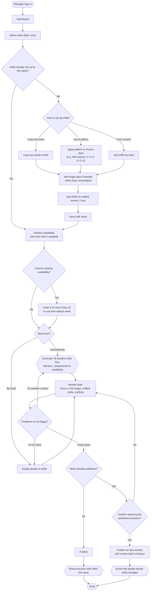
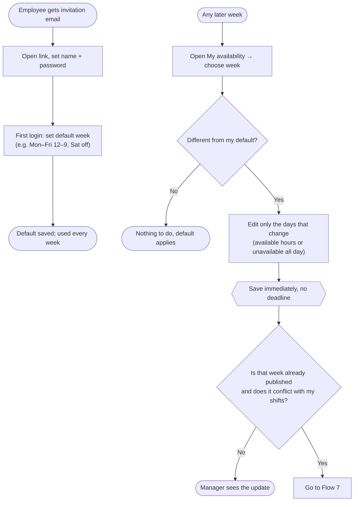
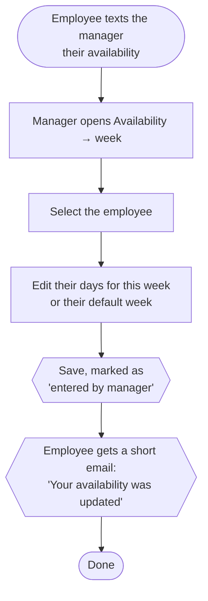
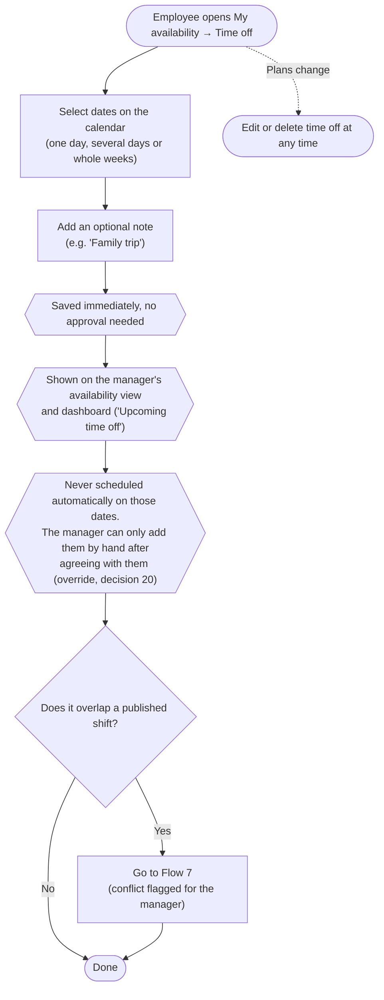
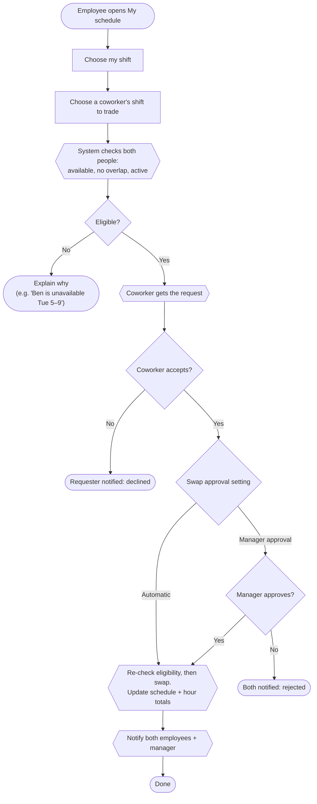
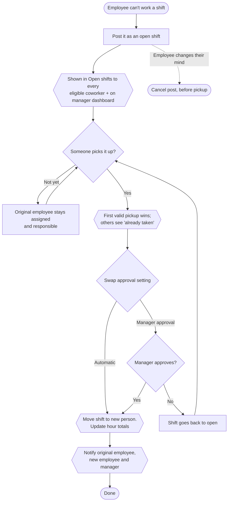
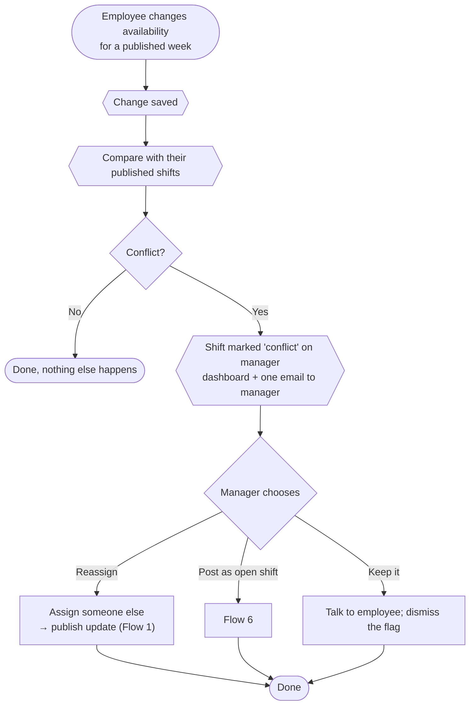
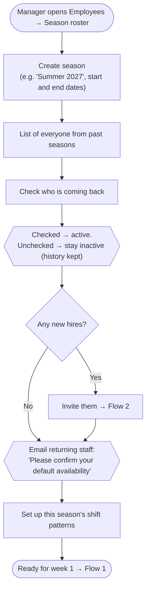

# User flows

> Phase 4 — Information architecture. Flows 1, 2 and 5 replace the ones in the requirements document; the rest are new. All follow the client decisions in `technical-plan.md` §7.
>
> **Shape key:** rounded = start/end · rectangle = step · diamond = decision · hexagon = the system acts automatically.

| # | Flow | Who | Status |
|---|---|---|---|
| 1 | Build and publish the weekly schedule | Manager | Updated |
| 2 | Join and set availability | Employee | Updated (deadline removed) |
| 3 | Enter availability for an employee | Manager | New |
| 4 | Add time off | Employee | New |
| 5 | Swap a shift with a coworker | Employee | Updated |
| 6 | Post and pick up an open shift | Employee | New |
| 7 | Availability changes after publishing | Employee → Manager | New |
| 8 | Start a new season | Manager | New |

---

## 1. Build and publish the weekly schedule

**Notes**
- "Try another version" regenerates with the same shifts and availability, so the manager can compare options.
- Regenerating never touches a published schedule until the manager confirms (requirement in the spec).

---

## 2. Join and set availability (employee)

**Changes from the original flow:** the *"Is the deadline still open?"* decision and the *"request an exception"* branch are removed (decision 6). Recurring default availability is added (decision 7).

---

## 3. Enter availability for an employee (manager)

**Why:** it eases the move away from text messages. Employees can still edit their own availability at any time.

---

## 4. Add time off

**Notes**
- Time off doesn't need manager approval for this client. The employee adds it to the calendar, and the manager sees which days or weeks that person can't work.
- The manager can also add time off for an employee, the same way they enter availability for them (Flow 3).

---

## 5. Swap a shift with a coworker

**Changes from the original flow:** the approval step is now a manager setting (decision 10). Eligibility is checked again at the moment of the swap, in case something changed while waiting.

---

## 6. Post and pick up an open shift

**Notes**
- No acceptance from the original employee is needed (decision 11).
- No time limit: an open shift can be picked up right up until it starts.

---

## 7. Availability changes after publishing

**Rule:** the published schedule never changes by itself.

---

## 8. Start a new season

**Notes:** inactive employees can't log in to the employee area and are never scheduled. They can be reactivated in any later season.
